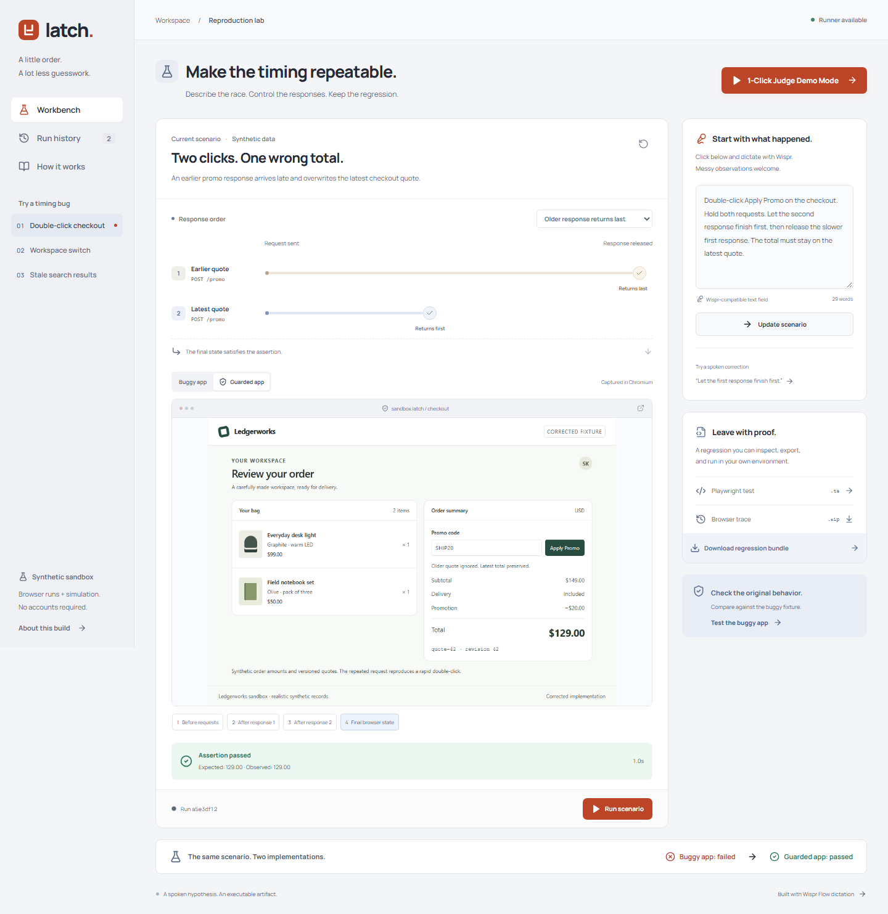
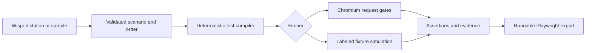

# Latch

**Make the timing repeatable.**

Turn a spoken timing-bug hypothesis into a controlled experiment and a runnable Playwright regression. Built for solo developers who can describe a race but struggle to reproduce it reliably.

**[Open the public judge demo](https://latch-production-e63d.up.railway.app)** · [Submission summary and 90-second script](SUBMISSION.md)

No signup. No API key. No local setup for judges. Click **1-Click Judge Demo Mode**.



## The problem behind it

In my checkout workflow, a rapid double-click on **Apply Promo** sent two concurrent API requests. The earlier, slower response arrived last and corrupted the total. Latch captures that temporal explanation as an explicit order and assertion.

The interaction is based on the builder's own incident. All products, quote versions, amounts, invoices, and companies in the shipped fixtures are synthetic.

| Try this | Buggy app, older response last | Guarded app, same order |
| --- | --- | --- |
| Double-click checkout | Stale quote overwrites total: **$149** | Latest quote remains: **$129** |
| Acme → Nimbus invoices | Acme data replaces Nimbus invoices | Nimbus keeps its own invoices |
| `inv` → `invoice` search | Old query replaces current results | Results match `invoice` |

## A judge's first minute

1. Click **1-Click Judge Demo Mode**. Inspect the checkout failure and response lanes.
2. Dictate “Let the first request finish first” with Wispr Flow. Click **Update scenario**, then **Run scenario**.
3. Restore “Let the second request finish first.” Compare **Buggy app** with **Guarded app**.
4. Inspect **Playwright test** and download the regression bundle and evidence archive.

Wispr Flow inserts dictation into the normal narration field. The build requirements and iterations were also dictated through Wispr. Latch does not record audio, require a Wispr SDK, or fabricate usage-card statistics. Without a server-side model key, the labeled built-in interpreter supports the supplied scenarios, named workspace responses, ordering changes, and self-corrections. Ambiguity produces a clarification.

## Reliable execution, honest evidence

| Runner mode | Behavior | Evidence |
| --- | --- | --- |
| `auto` — default | Try Chromium; fall back if execution is unavailable. Cool down for 60 seconds before retrying a failed browser. | Real screenshots and Playwright trace, or explicitly labeled simulation snapshots/report |
| `playwright` | Require the real browser; return a controlled error if it cannot run. | Captured browser screenshots and `trace.zip` |
| `simulation` | Run the finite fixture model without launching Chromium. | Labeled SVG snapshots and `simulation-report.zip` |

Both paths preserve the selected request order and buggy/guarded state rules. Every export includes an executable Playwright test, standalone fixtures, a local fixture server, configuration, and `run-mode.json`. A simulation report is **not** a Playwright trace or proof of actual browser execution. The UI identifies the engine used.

The runner accepts only supported fixtures and validated actions. It does not execute arbitrary model-generated code or browse external targets. A failed invariant is an expected reproduction of the seeded defect; it is separate from an infrastructure error.

## Run locally

Requires **Node.js 24+** and npm. Chromium is optional when using simulation mode.

```sh
npm ci
npx playwright install chromium
npm run dev
```

Open [localhost:4317](http://localhost:4317). Vite serves the interface and proxies the API/fixture requests to Fastify on port 4318. There is no database to provision or seed.

Production build, with interface and API on one port:

```sh
npm run build
npm start
```

Open [localhost:4318](http://localhost:4318), or the configured `PORT`.

## Deploy with one command

With Docker Engine and Compose running, from this checkout:

```sh
docker compose up --build -d
```

Open [localhost:8080](http://localhost:8080). The container installs Chromium, builds the client, runs as a non-root user, and health-checks `/api/health`. First builds download browser/system dependencies, so elapsed time depends on the host.

For a host that cannot install or launch Chromium, put these two values in a Compose environment file, then use `docker compose --env-file <file> up --build -d`:

```dotenv
LATCH_INSTALL_CHROMIUM=0
LATCH_RUNNER_MODE=simulation
```

**Railway:** this private repository is already connected on branch `codex/build-latch`. `railway.json` selects the Dockerfile and `/api/health`; pushing a verified commit deploys automatically:

```sh
git push origin codex/build-latch
```

For another Docker-capable host, use the same Dockerfile, expose its assigned `PORT`, and make the service public. This configuration targets container hosts such as Railway, Render, and Fly.io. A Vercel deployment would additionally need a serverless adapter and suitable artifact storage; this persistent Fastify service is not a drop-in Vercel function.

## Configuration

Set these in the server process or hosting service. No variable is required for the seeded judge path.

| Variable | Default | Purpose |
| --- | --- | --- |
| `PORT` | `4318`; container `8080` | Single HTTP listener |
| `LATCH_RUNNER_MODE` | `auto` | Browser/fallback selection |
| `LATCH_DATA_DIR` | OS temp directory + `latch-runs` | Writable artifact location |
| `LATCH_INSTALL_CHROMIUM` | `1` | Docker build argument; `0` skips browser installation |
| `PLAYWRIGHT_BROWSERS_PATH` | Playwright default; container `/ms-playwright` | Browser executable location |
| `OPENAI_API_KEY` | unset | Optional structured narration interpretation; keep server-side |
| `OPENAI_MODEL` | `gpt-4o-mini` | Optional interpretation model |
| `LATCH_TEST_URL` | local development URL | Browser-suite target |
| `LATCH_EXPECT_SIMULATION` | unset | Assert simulation evidence in browser tests |

Artifacts are temporary and may disappear when a host restarts. Download evidence worth retaining. Use a writable temp location on restricted filesystems. Hosted services must permit filesystem writes there; fallback does not replace artifact storage.

## How it works



React + TypeScript + Vite power the workbench. Fastify owns HTTP, a bounded queue, execution and artifact delivery. Zod validates the finite scenario language. Playwright holds and releases actual requests; the fallback applies the equivalent finite fixture state model. SVG simulation snapshots are generated from those states without a browser.

| Directory | Responsibility |
| --- | --- |
| `src/` | Workbench, narration, timeline, evidence and history |
| `domain/` | Scenario manifests, validation, parser, compiler, request protocol and simulation model |
| `server/` | Browser runner, fallback orchestration, artifact packaging and API |
| `public/fixtures/` | Dedicated checkout, invoices and search applications |
| `tests/` | Browser workflows, downloads, mobile layout and accessibility |

## Verification

```sh
npm run lint
npm test
npm run build
npm run test:e2e
```

The suite checks both orders and implementations, voice corrections, dedicated iframe pages, image loading, downloads, keyboard access, reduced motion and automated accessibility. Model/runner failure tests verify clarification and fallback. Browser checks can target the deployed URL using `LATCH_TEST_URL`; set `LATCH_EXPECT_SIMULATION=1` when testing a simulation host.

To run a downloaded regression, extract its ZIP, then run `npm install`, `npx playwright install chromium`, and `npm test` in that directory. A bundle exported from a buggy stale-last run intentionally fails its assertion. Set `LATCH_VARIANT=fixed` in the shell to verify the corrected fixture.

## Submission

Built solo for **No Hands: The Wispr Challenge**, WeMakeDevs × Wispr Flow. See [SUBMISSION.md](SUBMISSION.md) for the paste-ready summary, timed voiceover, evidence boundaries, and recording checklist. Attach a genuine demo video and Wispr Insights usage card; these are not generated by the app.
